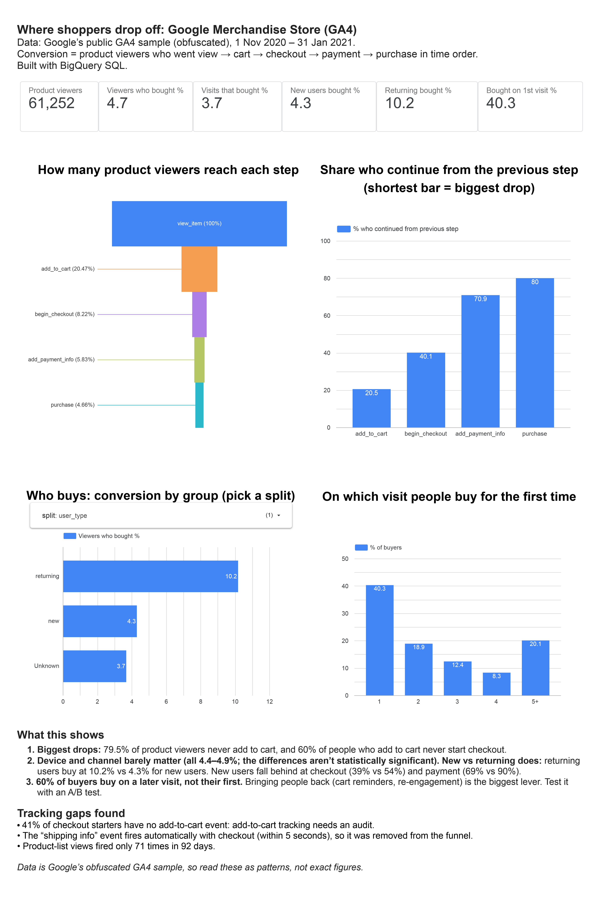

# Where shoppers drop off: a GA4 e-commerce funnel analysis in BigQuery SQL

Where do shoppers on the Google Merchandise Store drop out between viewing a product and buying it, who drops out most, and what can't the tracking explain?

**Dashboard:** [GA4 Funnel Analysis – Google Merchandise Store (Data Studio)](https://datastudio.google.com/reporting/bf09abb2-8baf-490e-8d04-222c9c21675a)

**Tools:** BigQuery (standard SQL) · Data Studio (formerly Looker Studio) · GA4 event data

---

## Headline results

| | |
|---|---|
| Product viewers | **61,252** |
| Viewers who bought, following the steps in order | **4.7%** (2,856 buyers) |
| Visits with a product view that ended in a purchase | **3.7%** |
| New users vs returning users who bought | **4.3% vs 10.2%** |
| Buyers who bought on their first visit | **40.3%** |

**The funnel (users, steps in time order)**

| Step | Users | Continued from previous step | % of viewers |
|---|---|---|---|
| View a product | 61,252 | – | 100.0% |
| Add to cart | 12,538 | **20.5%** | 20.5% |
| Begin checkout | 5,034 | **40.1%** | 8.2% |
| Add payment info | 3,568 | 70.9% | 5.8% |
| Purchase | 2,856 | 80.0% | 4.7% |

---

## Findings

**1. The two big drops come before checkout.** 79.5% of product viewers never add to cart, and 60% of people who add to cart never start checkout. After checkout starts, 71% add payment and 80% of those buy.

**2. Device and channel barely matter, but new vs returning does.**
- Every device and traffic medium converts at 4.4–4.9%. The gaps aren't statistically significant (mobile vs desktop p = 0.17; best vs worst medium p = 0.18).
- Returning users buy at **10.2% vs 4.3%** for new users (p < 0.0001). They're 6.4% of viewers but 14% of buyers.
- New users fall behind **at checkout** (38.9% vs 54.4% of carters start it) and **at payment** (68.9% vs 90.1%), not at add-to-cart.
- This is correlation, not cause: returning users came back because they were already interested.

**3. Most buyers come back before buying.** Only 40.3% buy on their first visit, and 20.1% need five or more visits. Yet the visit where they do buy usually contains the whole funnel (purchase sessions 2,834 ≈ in-order buyers 2,856). People research across visits, then buy in one go.

## Recommendations

| Finding | What I'd try | How to measure it |
|---|---|---|
| 60% of carters never start checkout; most buyers return before buying | Abandoned-cart reminders (push/email) for people who add to cart but don't check out | A/B test: reminder vs no reminder, measure checkout starts and purchases |
| New users lose most at checkout and payment | Trust signals, guest checkout or a first-order offer for first-time buyers | A/B test on new users, measure checkout → payment and payment → purchase |
| Tracking gaps (below) | Fix the events before trusting checkout-stage numbers | Re-run the closed funnel: the gap to the open funnel should shrink |

---

## Data

- **Source:** Google's public [GA4 obfuscated sample e-commerce dataset](https://developers.google.com/analytics/bigquery/web-ecommerce-demo-dataset) (`bigquery-public-data.ga4_obfuscated_sample_ecommerce.events_*`): a sample of the Google Merchandise Store's GA4 event export, obfuscated by Google.
- **Size:** 4,295,584 events from 270,154 users over 92 days (1 Nov 2020 – 31 Jan 2021).
- **Obfuscation:** Google notes that some fields hold placeholders (`<Other>`, NULL, `''`) and that the dataset's internal consistency may be limited. So findings are **patterns, not exact figures**.

## Metric definitions

| Term | Definition |
|---|---|
| User | One `user_pseudo_id`, which is a browser, not a person |
| Session | `user_pseudo_id` + `ga_session_id` (from `event_params`) |
| Reached a step | Did every earlier step **before** this one, in time order (by `event_timestamp`). Same rule as Mixpanel and GA4 funnels by default. |
| Step rate | Users at this step ÷ users at the previous step |
| Conversion | Purchasers ÷ users who viewed a product |
| User's medium / device | The value on their **earliest** event; placeholders (`<Other>`, `(data deleted)`) go to Unknown |
| New vs returning | Returning = first-ever visit (`user_first_touch_timestamp`) before 1 Nov 2020 |
| Visits to first purchase | `ga_session_number` of a user's first purchase |

**Funnel steps:** `view_item` → `add_to_cart` → `begin_checkout` → `add_payment_info` → `purchase`. `add_shipping_info` was **removed** (see tracking gap 2).

---

## How the funnel is built

1. **Open funnel (`08`):** anyone who did each event at all. It's the upper bound: 7.2% of viewers bought.
2. **Closed, "ever" (`09a`):** users who did every earlier step at some point: 4.8%.
3. **Closed, in time order (`09b`, `09d`):** walk forward in time. Take each user's first view, then their first cart **at or after** that view, then their first checkout at or after that cart, and so on, using one CTE per step. Comparing only "first view time vs first cart time" would wrongly drop someone who carted at 09:00, viewed at 09:10 and carted again at 09:12.
4. **The shipping event broke the in-order funnel** (`09b`): only 62.5% of checkouts had shipping *after* them. `09c` measured the gap for the 1,890 users dropped there: **every one was under 5 seconds**, so the event fires with checkout and sometimes gets recorded before it. Removing it gave the final funnel (`09d`): **4.7%**.
5. **Session funnel (`10b`):** the same walk, but every step must be in the same visit (`UNNEST(event_params)` for `ga_session_id`).
6. **Segments (`11`):** label each viewer by their earliest event (`ROW_NUMBER() OVER (PARTITION BY user ...)`), attach the steps with `LEFT JOIN`, and count with `COUNT(column)`. In each split, viewers add back to 61,252 and buyers to 2,856.

Significance tests are two-proportion z-tests, computed outside SQL.

---

## Data quality and tracking gaps

| # | What I found | Evidence | Query |
|---|---|---|---|
| 1 | **`add_to_cart` is missing for 41% of checkout starters** (3,981 of 9,715 viewed but never carted). 86% of them aren't returning users, so it isn't explained by carts made before the data starts. | Checkout starters by path, % returning | `13` |
| 2 | **`add_shipping_info` fires automatically with checkout:** 100% of checkout users have it, and it's recorded up to 5 s *before* `begin_checkout` | Gap check on 1,890 users | `09a`, `09b`, `09c` |
| 3 | **`view_item_list` barely fires:** 71 events in 92 days (on 33 days, never more than 8 a day) against 31,007 `select_item` | Events per day | `02`, `03` |
| 4 | **"First" traffic source isn't fixed per user:** 15.2% of users have more than one, and placeholders (`<Other>` 18.9%, `(data deleted)` 6.7% of users) are common. Likely obfuscation here. | Mediums per user, reconciled exactly (58,420 extra rows) | `04`, `05` |
| 5 | Device and country are clean: at most 1.6% of users with more than one device; country `(not set)` 0.8% | Totals checked against 270,154 users | `06`, `07` |

**Tracking plan: what I'd fix or add**

| Event | Change | What it would let us measure |
|---|---|---|
| `add_to_cart` | Audit every add-to-cart route (product page, quick-add, "buy now", quantity change) | A true view → cart rate |
| `add_shipping_info` | Fire only when the address form is submitted | Drop-off at the address form |
| `view_item_list` | Fire on every product list, with `item_list_name` | Which lists lead to product views |
| `checkout_error` (new) | Send when a checkout form shows an error | Whether new users drop because of form problems |
| `payment_failed` (new) | Send when a payment is declined | Failed payments vs changed minds |
| `remove_from_cart` (new) | Add the GA4 recommended event | A cart left full vs one emptied |

---

## Queries

All queries are in [`sql/`](sql/) and run on the public dataset from any Google Cloud project (the BigQuery sandbox is free). Each query's output is saved as a CSV with the same name in [`results/`](results/), so you can see the numbers without running anything.

| File | Question | Key result |
|---|---|---|
| `01_size_check` | How big is the data? | 4.3M events, 270,154 users, 92 days |
| `02_event_count` | Which events exist? | 17 events, all funnel steps present |
| `03_view_item_list_by_day` | Was the list-view gap a one-day outage? | No: 71 events spread thinly over 33 days |
| `04_traffic_medium` | Users per traffic medium | Sums to 328,574 > 270,154 users |
| `05_mediums_per_user` | How many users have more than one medium? | 41,164 (15.2%), exactly explaining the 58,420 gap |
| `06_device_category` | Users per device | Clean; at most 1.6% overlap |
| `07_country` | Users per country | 109 countries; each user has exactly one |
| `08_funnel_users_open` | Open funnel | 7.2% |
| `09a_funnel_users_ever` | Closed funnel, "ever" | 4.8% |
| `09b_funnel_users_in_order` | Closed funnel, in time order, 6 steps | 3.3%, distorted by the shipping event |
| `09c_shipping_gap_check` | Why does shipping break the order? | All 1,890 gaps under 5 s |
| `09d_funnel_users_final` | **Headline funnel**, in order, 5 steps | **4.7%** |
| `10a_session_id_check` | Do all funnel events have a session ID? | Yes, 0 missing of 502,959 |
| `10b_funnel_sessions` | Funnel within one visit | 3.7% |
| `11_funnel_by_segment` | Funnel by device, medium, new vs returning | Returning 10.2% vs new 4.3% |
| `12_sessions_to_first_purchase` | On which visit do people first buy? | 40.3% on visit 1 |
| `13_checkout_without_cart` | Is the missing add-to-cart a data-window effect? | No: 86% aren't returning users |

---

## Caveats

- **Obfuscated sample:** read findings as patterns, not exact figures.
- **A user is a browser,** so one person on two devices counts twice.
- **The data starts on 1 Nov 2020.** "Returning" means a first visit before that, and anything before it is invisible.
- **The funnel follows the person, not the product.** Viewing X and buying Y counts as a conversion. "Which products convert?" is a separate analysis.
- **The closed funnel drops real buyers whose earlier events weren't tracked,** so the true conversion sits between the closed (4.7%) and open (7.2%) numbers.

## Next steps

- A weekly conversion trend (the period includes Black Friday and Christmas)
- The same dashboard in Power BI
- A product-level analysis: which items convert, using the `items` array
